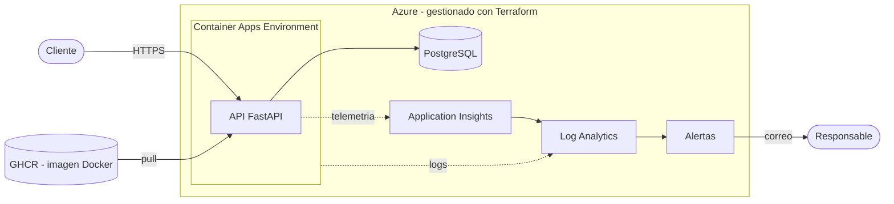
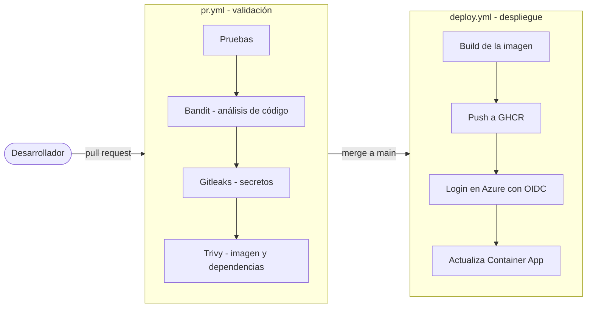

# azure-incident-platform

API de registro de incidentes desplegada en Azure, construida de punta a punta como proyecto de aprendizaje: **código, contenedores, infraestructura como código, CI/CD seguro y monitoreo**, incluyendo un incidente simulado documentado con su runbook y postmortem.

## Qué demuestra este proyecto

| Área | Qué se hace |
|---|---|
| **Backend** | API REST con FastAPI y PostgreSQL, validación de datos y pruebas automáticas |
| **Contenedores** | Imagen Docker ligera, con usuario sin privilegios, y entorno local con Docker Compose |
| **Infraestructura como código** | Todo en Azure se crea y se destruye con Terraform, sin clics en el portal |
| **CI/CD seguro** | GitHub Actions con autenticación OIDC (sin contraseñas guardadas) y escaneo de secretos, código e imágenes |
| **Observabilidad** | Logs y métricas en Application Insights y Log Analytics, con alertas y dashboard |
| **Operación** | Un incidente simulado, resuelto y documentado con runbook y postmortem |
| **Control de costos** | Presupuesto con alertas creado antes que cualquier otro recurso |

## Arquitectura

La API corre como contenedor en Azure Container Apps, guarda sus datos en PostgreSQL y envía logs y telemetría a Application Insights y Log Analytics, donde se evalúan las alertas.



## Flujo de CI/CD



**OIDC en una línea:** GitHub Actions obtiene un token temporal mediante una **User-Assigned Managed Identity** federada al environment `dev`, así que no existen contraseñas ni `client_secret` en el repositorio.

## Stack

| Capa | Tecnología |
|---|---|
| API | Python 3.12, FastAPI, SQLAlchemy 2, Pydantic, Microsoft OpenTelemetry |
| Base de datos | PostgreSQL 16 (Azure Flexible Server) |
| Contenedores | Docker, Docker Compose |
| Infraestructura | Terraform (providers `azurerm`, `random`) |
| Nube | Azure: Container Apps, Log Analytics, Application Insights, Azure Monitor |
| Registro de imágenes | GitHub Container Registry (GHCR) |
| CI/CD | GitHub Actions con OIDC (Managed Identity) y Environment `dev` |
| Seguridad | Gitleaks, Bandit, Trivy |

## API

| Método | Ruta | Descripción |
|---|---|---|
| `GET` | `/health` | Estado del servicio (usado por las sondas de salud) |
| `POST` | `/incidents` | Registra un incidente (`title`, `description`, `severity`) |
| `GET` | `/incidents` | Lista los incidentes |
| `GET` | `/incidents/{id}` | Detalle de un incidente |
| `PATCH` | `/incidents/{id}` | Cambia el estado (`open` / `resolved`) |

`severity` acepta `low`, `medium`, `high` y `critical`; cualquier otro valor se rechaza con `422`. La documentación interactiva queda en `/docs`.

## Ejecutar en local

Requisitos: Docker Desktop.

```bash
docker compose up --build
```

La API queda en `http://127.0.0.1:8000` (documentación en `/docs`) y los datos de PostgreSQL persisten entre reinicios.

```bash
curl http://127.0.0.1:8000/health
```

Pruebas (usan SQLite en memoria, no necesitan Docker):

```bash
python -m venv .venv
.venv\Scripts\Activate.ps1        # Windows. En Linux/macOS: source .venv/bin/activate
pip install -r requirements-dev.txt
pytest
```

## Estructura del repositorio

```
.
├── .github/workflows/    # CI/CD: pr.yml (validación y seguridad) y deploy.yml (GHCR + OIDC)
├── app/                  # API FastAPI + telemetría con Microsoft OpenTelemetry
├── tests/                # Pruebas automatizadas con pytest y SQLite en memoria
├── infra/                # Terraform: presupuesto, RG, PostgreSQL, Container Apps, monitoreo y alertas
├── docs/                 # Runbook, postmortem del incidente simulado y ADRs
├── Dockerfile            # Imagen ligera (usuario no-root y paquetes SO parcheados)
├── docker-compose.yml    # API + PostgreSQL para desarrollo local
├── requirements.txt      # Dependencias de producción
└── requirements-dev.txt  # Dependencias de desarrollo y pruebas
```

## Decisiones de diseño

- **Presupuesto primero.** La alerta de costos se crea antes que cualquier recurso, porque la nube factura por uso.
- **Configuración por entorno.** La API lee `DATABASE_URL` de una variable de entorno; el mismo código corre con SQLite en pruebas, PostgreSQL en local y Azure en producción.
- **Dependencias separadas.** La imagen solo instala lo que la API necesita; `pytest` y compañía quedan fuera, lo que reduce el tamaño y la superficie de ataque.
- **Nada sensible en el repositorio.** Los valores personales van en `terraform.tfvars` (ignorado por git) y las credenciales de CI se obtienen por OIDC.
- **Todo reproducible.** La infraestructura completa se crea con `terraform apply` y se elimina con `terraform destroy`.

## Cómo se construyó

1. **App local:** API, Dockerfile, docker-compose y pruebas
2. **Terraform:** presupuesto con alertas e infraestructura base en Azure
3. **Primer despliegue manual:** imagen en GHCR y API en Container Apps
4. **CI/CD:** `pr.yml` y `deploy.yml` con OIDC y escaneos de seguridad
5. **Observabilidad:** 3 alertas y dashboard
6. **Documentación operativa:** runbook, postmortem del incidente simulado y ADRs

## Documentación operativa

- [Runbook](docs/runbook.md): triage inicial, respuesta a las 3 alertas y rollback rápido
- [Postmortem](docs/postmortem.md): incidente simulado de caída de PostgreSQL, línea de tiempo real, hallazgos y acciones preventivas
- [ADRs](docs/adr/README.md): decisiones de arquitectura, seguridad y costos (GHCR, OIDC con Managed Identity, scale-to-zero y red de BD)
